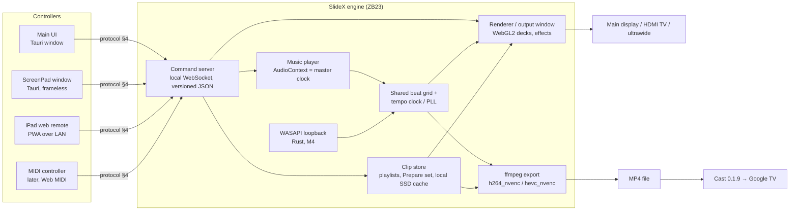

# SlideX Phase 2 Spec: Beat-Synced Slideshows, Auto-Stitch, Live Visual DJ, ScreenPad & iPad Controllers

**Status:** draft for John / Senior Dev review. Committed to the repo in PR #37 for Senior Dev review (Oct 12, 2026).  
**Inputs:** John (scope, milestone order), Senior Dev (beat engine, GPU, cast simplification), App QA (instrumentation, fixtures, scoring), Homelab (share, GPU, network, cast delay). Collected Oct 9, 2026.  
**Starts after:** SlideX **0.1.8** and **Cast 0.1.9** ship.  
**Target machine:** ZB23 (Intel iGPU + NVIDIA RTX 4060 hybrid; ASUS ScreenPad Plus; local SSD). **Media source:** `\\AX03\Archive01`.  
**Base build:** 0.1.8 (already launches with `--force_high_performance_gpu`).

---

## 1. Goals & non-goals (summary)

**Goals (John's ask)**
1. **Music-video-style slideshows** that follow the music's beat: photos, Ken Burns moves and video cuts land on beats (M1).
2. **Auto-stitch** a clip set into a beat-cut MP4, which can also be cast (M2).
3. **Live visual DJ** for music events: pads, two decks, crossfader, effects, following live audio (M3 spike → M4).
4. **2.1 ScreenPad touch controller**: the DJ surface on ZB23's ScreenPad Plus (M5).
5. **2.2 iPad controller**: the same surface as a LAN web remote, no App Store (M6).

**Non-goals (details in §11)**
- No Spotify integration beyond system-audio loopback, and no streaming service in M1 (local files only).
- No frame-accurate sync over Cast with split audio. Cast gets a rendered MP4 (M2).
- No standalone iPad app, no cloud relay, no music licensing for events.

---

## 2. Milestones

M1 comes first because it's the cheapest step and builds the beat grid everything else uses.

| # | Milestone | Target version* | Depends on | Gate | Effort |
|---|-----------|-----------------|------------|------|--------|
| **M1** | Music player + beat-synced slideshow (local MP3/FLAC/WAV) | **0.2.0** | 0.1.8, Cast 0.1.9 shipped | AC-M1-* (1 frame / no drift over a full song) | **M** |
| **M2** | Auto-stitch export (reuses the M1 beat grid) + **render-then-cast** of beat-synced slideshows | **0.3.0** | M1 beat grid; Cast 0.1.9 for the cast part | AC-AS-*, AC-AS-CAST-1 | **M** |
| **M2+** | Auto-video from photos and videos (extends M2 auto-stitch; 0.1.9 and 0.1.10 unchanged) | — | M2; Ken Burns cast (0.1.10) planner and encoder, then the analysis pass | acceptance list in that section | — |
| **M3** | Live-mode spike (pads), **pass/fail** | **0.4.0-spike.1** (pre-release, not a release) | M1 clock, M2 grid | AC-LM-* (60 fps/30 min, ≤100 ms) | **S** (spike); **L** if a fail path is taken |
| **M4** | Live beat-following from system audio + live visual DJ (+ live encoded cast stream, if pursued) | **0.4.0** | M3 PASS; Cast 0.1.9 | AC-BF-* (lock ≤8 beats, ≤50 ms) | **L** |
| **M5** | 2.1 ScreenPad controller | **0.5.0** | M3/M4, protocol (§4) | AC-SP-* | **M** |
| **M6** | 2.2 iPad web remote | **0.6.0** | M5 screens, protocol (§4) | AC-IR-* | **M** |

**Cast note (Senior Dev simplification):** M1 promises beat sync **only on directly wired displays**. **Casting a beat-synced slideshow arrives with M2**: the slideshow is rendered to an MP4 by the auto-stitch export, then that file is cast (requires **Cast 0.1.9**). **Live encoding to the TV is M4+ only** (live mode / live beat-following), never M1.

\*Proposed version targets (D-3). Patch releases (0.x.y) stay available for fixes between milestones. Effort is relative (S < M < L). There are no dates.

---

## 3. Architecture overview

One **engine** owns media, time and output. Every **controller** is a thin client that speaks the same protocol (§4).



- **Clip store:** playlists and sets. Allowlisted paths only. Prepare set copies clips to the local SSD for live use (R-LM-5).
- **Beat grid / tempo clock:** one analyzer and one grid (R-BE-1). Offline analysis of local files (M1). Live PLL prediction from loopback (M4).
- **Music player:** owns the `AudioContext`, which is the master clock (R-BE-2).
- **Renderer / output window:** WebView2 + WebGL2 deck mixing (M3 approach, §7). Fullscreen output to a wired display.
- **ffmpeg export:** renders EDL timelines to MP4 (M2). That MP4 is the **only** Cast path for beat-synced content before M4.

---

## 4. Command protocol (all controllers)

- **Transport:** local **WebSocket** served by the engine. The **same versioned JSON messages** are used by the main UI, ScreenPad, iPad and, later, the MIDI bridge.
- **LAN-only.** No cloud relay. **A pairing code is required** for any non-local client (iPad). The local Tauri windows never auto-pair: they authenticate with a fresh random secret made at each launch, and the engine checks the WebSocket `Origin` (R-SEC-1).
- **Beat quantization:** the engine **quantizes triggers to the next beat** (or bar, per setting) using the shared clock. **Wi-Fi lag never puts a cut off-beat**, because a late message still fires on the next grid point. Messages carry a client timestamp so the engine can log lag. `quant: "off"` exists for latency testing (AC-LM-2) and immediate pads.
- **Versioning:** `hello` exchanges `proto` versions. The engine rejects incompatible major versions with a clear error.

**Message set**

| Type | Direction | Purpose |
|------|-----------|---------|
| `hello` / `version`, `pair` | C→E, E→C | Handshake, protocol version, pairing code, client role |
| `set.load` | C→E | Load a set or playlist (by ID; engine resolves allowlisted paths) |
| `music.transport` | C→E | play / pause / seek / next / prev / volume |
| `pad.trigger` | C→E | Fire a pad (quantized) |
| `xfader.set` | C→E | Crossfader position 0..1 |
| `tempo.tap` | C→E | Tap tempo / nudge phase |
| `fx.set` | C→E | Effect on/off and parameter |
| `deck.transport` | C→E | Deck A/B play / pause / cue |
| `state.snapshot` / `state.sync` | E→C | Full state on connect, then deltas (beat, bar, BPM, decks, pads, fx) |
| `heartbeat` | both | Liveness and RTT. The UI shows "disconnected" after a missed heartbeat window |

**Example**
```json
{"v":1,"type":"pad.trigger","id":"c-0192","ts":1791531600123,"pad":7,"deck":"A","quant":"beat"}
```

---

## 5. Shared beat engine (applies to M1–M4) [Senior Dev]

- **R-BE-1 One analyzer, one grid.** There is exactly **one** shared beat analyzer that produces **one** beat-grid format: the timestamp of every beat, plus bar/downbeat markers (and tempo/confidence). Beat-synced slideshow (M1), auto-stitch (M2), and live mode (M3/M4) all use it. No feature gets its own beat detector.
- **R-BE-2 Audio clock is the master.** All visual scheduling is driven by the **audio clock**: `AudioContext` playback position **minus `outputLatency`**. It is **never** driven by `setTimeout`/`setInterval` or other timers.
- **R-BE-3 Peak on the beat.** Each transition **starts early** so its **peak** lands exactly on the beat.
- **R-BE-4 Pre-decode.** The next image or clip is **decoded at least one beat ahead** of when it's needed.
- **R-BE-5 Sync-offset slider.** A user **sync offset (ms)** slider compensates for HDMI/Bluetooth speaker delay. It's **saved** and persists across sessions (ideally per output device).
- **R-BE-6 Self-timing log.** The app logs its own timing (scheduled beat time vs actual frame presentation time per transition, from `requestVideoFrameCallback`) to a machine-parsable file for App QA.
- **R-BE-7 License check before bundling.** No beat/onset/tempo library is bundled until its license has been checked (e.g. **aubio = GPL**, **essentia = AGPL**). Prefer **permissive** (MIT/BSD/Apache) or **in-house** onset/tempo detection (D-2).

---

## 6. M1: Music player + beat-synced slideshow (local files) [John]

### 6.1 Requirements
- **R-M1-1** Built-in **music player with its own playlist** (separate from the image/video playlist). It is the **master clock** for the slideshow.
- **R-M1-2** Supports **local MP3, FLAC, WAV**.
- **R-M1-3** Files are **analyzed ahead of time** for an exact beat grid (R-BE-1). The grid is **cached per file** (path + size/mtime or content hash).
- **R-M1-4** **Photo transitions, Ken Burns moves, and video cuts land on beats.**
- **R-M1-5** Pacing options: **"change every N beats"**, **"every bar"** (downbeat-aligned), and similar.
- **R-M1-6** **Transition intensity scales with loudness/energy.**
- **R-M1-7** Long term the goal is a Spotify-like experience, but **M1 is local files only** (§11).
- **R-M1-8 Scope: wired displays only.** Frame-accurate beat sync covers **only displays wired directly to ZB23**: the **main display**, the **ScreenPad**, and **HDMI to the TV**. There is no cast beat-sync promise in M1 (§6.4).

### 6.2 Acceptance criteria
- **AC-M1-1 (accuracy):** for a **full song** from a local file, every transition peak lands **within 1 frame (≈17 ms at 60 fps)** of its beat.
- **AC-M1-2 (no drift):** error at the **end** of the song is no larger than at the start.
- **AC-M1-3:** the sync-offset slider value survives a restart and shifts transitions by the set amount.
- **AC-M1-4:** opening an already analyzed file uses the cached grid (no re-analysis in the log).
- **AC-M1-5 (fixture scoring):** all of the above are scored against the fixture set (§6.3) on a wired display, using screen captures **recorded with system audio** (R-M1-FX-3) plus the in-app log.

### 6.3 Beat-sync test fixture set (ships with M1) [App QA]
- **R-M1-FX-1** Each fixture track has a **ground-truth JSON** file next to it (beat timestamps in ms, downbeat flags, tempo segments, source, license).
- **R-M1-FX-2** Fixtures: (1) **steady 120 BPM click track**; (2) **click track with a tempo change midway**; (3) **track with silence and a long fade**; (4) **one real song with hand-marked beats**, **CC0, permissive or self-made**, with its license recorded in the JSON and a fixtures README. Tracks 1–3 are self-generated.
- **R-M1-FX-3 Scoring method:** App QA records **screen captures with system audio** (ZB23's actual output, in the same recording) and measures each **transition's start and peak against the audible click/beat**, plus the ground truth. This scores what is **heard**, not just what was scheduled.
- **R-M1-FX-4** The in-app timing log also reports, per transition, **scheduled time vs ground-truth beat** and the **delta (ms)**, plus scheduled vs presented frame time.
- **AC-M1-FX-1:** for every fixture, every transition peak is within 1 frame of the **heard** beat in the capture, and of the ground truth in the log.
- **AC-M1-FX-2:** the capture and the log agree. A consistent gap means latency compensation or the offset is wrong, and it counts as a fail until fixed.

### 6.4 Cast interaction (Google TV) [Homelab, simplified by Senior Dev]
- **Problem:** Cast adds a **variable delay of about 1 to a few seconds**, so ZB23 speakers plus TV picture **can't be kept on-beat with a sync slider**.
- **R-M1-CAST-1** M1 promises beat sync **only on wired displays**. M1 does **not** cast beat-synced slideshows.
- **R-M1-CAST-2 Render then cast (M2):** SlideX **renders the slideshow to an MP4 with the auto-stitch export** (picture and music in one file, exact sync) and **casts that file**. The TV plays the file's audio. Needs **Cast 0.1.9** (`docs/cast-spike.md`).
- **R-M1-CAST-3** **Live encoding to the TV is M4+ only** (live mode / beat-following).
- **R-M1-CAST-4** The sync-offset slider is for **wired** delay only. The UI says so while a cast session is active.

---

## 7. M2: Auto-stitch export

### 7.1 Requirements
- **R-AS-1** Reuses the **shared M1 beat grid** (R-BE-1). **The audio is the master clock**: cuts are placed on the grid and video is conformed to the audio.
- **R-AS-2** Export **may read directly from** `\\AX03\Archive01` (no local copy needed). [Homelab]
- **R-AS-3 Render then cast:** a beat-synced slideshow (M1 grid + local music) exports to an MP4 (picture and music muxed) and can be cast to the Google TV. Needs Cast 0.1.9.
- **R-AS-4 Timeline JSON (EDL).** Auto-stitch produces an editable timeline first, then renders it. Each entry: `clip`, `in`, `out`, `transition` (type + duration), `beat`/`bar` anchor, plus `speed` and `locked`. The EDL is saved, so a re-render is deterministic.
- **R-AS-5 Options:** cut every **N bars** (or beats); **crossfade vs hard cut**; **speed-ramp on drops** (high-energy sections); order **shuffle / weighted**; **per-clip min/max length**; **lock** (pin clip and position) or **skip** individual clips.
- **R-AS-6 Render:** ffmpeg using **`h264_nvenc` / `hevc_nvenc` on the RTX 4060**, with software fallback if NVENC is unavailable. **MP4** output (H.264/HEVC + AAC). Progress and cancel. Bundling approach per D-4.

### 7.2 Acceptance criteria [App QA]
- **AC-AS-1 (beat sync):** in a **10-minute export**, **every cut** lands **within 1 frame** of its beat marker, from start to finish.
- **AC-AS-2 (no drift):** a **1-hour set** export shows **no audio/video drift** at the start, middle, or end.
- **AC-AS-CAST-1:** a rendered MP4 cast to the Google TV keeps cuts within 1 frame of its own audio, whatever the cast delay.

---

## Auto-video from photos and videos

Auto-video turns a set of photos and videos, plus the user's music, into one finished video. It extends the auto-stitch milestone: the same job of assembling a sequence, with a points-of-interest pass, beat-synced cuts, and subject-framed Ken Burns motion.

The run stays on the machine. Files are not uploaded.

### Triggers

Two entries start the same pipeline. Both run in the background, report progress, and stay fully local, with no upload.

| Trigger | Input | Output |
| --- | --- | --- |
| Watched folder | A folder named **Make a video**. A file is picked up only after its size has been stable for 5s. | A sibling output folder, beside the watched folder. That output folder is ignored. |
| In-app **Make video** | A playlist or a selection, a music track, and a target length. Placeholders the user picked are downloaded, with progress and cancel. | The finished video for that command. |

**Watched folder**

- A file is picked up only after its size has been stable for 5 seconds.
- SlideX ignores its own output folder, the sibling folder the finished video is written to.
- Cloud-only placeholder files are skipped, and each skip is logged. A placeholder carries `FILE_ATTRIBUTE_OFFLINE`, `RECALL_ON_OPEN`, or `RECALL_ON_DATA_ACCESS` (Nextcloud virtual files are the example). The watch does not download them.
- On a network share (`\\host\...`), the watch does not use change notifications. A background thread polls every 30–60 seconds. Each root uses the same per-root timeout as `paths_exist` (2.5s). If that root does not answer in time, the UI shows **folder unreachable** and the poll does not hang.

**In-app Make video**

The in-app command takes the music track and the target length with the playlist or the selection. It differs from the watch: placeholders the user picked are downloaded, with progress and cancel.

### Points-of-interest analysis

The analysis runs once per file. A repeat run with the same size, the same mtime, and the same first-and-last 4 MB hash reads the cache described below.

Videos are scored about once a second. Each sample records faces, saliency, motion, sharpness, exposure, and audio peaks. The pass keeps the best windows and skips stretches that are blurry, shaky, or dark.

Photos are scored once. Each photo gets face boxes and the most salient region.

| Signal | How it is measured |
| --- | --- |
| Faces | Face boxes from the face detector. |
| Saliency | The most salient region in the sample. |
| Motion | Motion in the sample. |
| Sharpness | Laplacian variance. Low variance marks a blurry stretch, which is skipped. |
| Exposure | Brightness of the sample. A dark stretch is skipped. |
| Audio peaks | Peaks in the clip's own audio. |
| Shake | Variance of optical-flow magnitude. A high variance marks a shaky stretch, which is skipped. |

Proposed models are small and permissively licensed. They run on the GPU through ONNX Runtime with the DirectML execution provider. Licenses below are the published claims. **Verify each license before adoption.**

| Job | Proposed model | Published license |
| --- | --- | --- |
| Face detection | YuNet | Apache-2.0 |
| Saliency | A small U2-Net-class model | Apache-2.0 |

Shake is measured from optical flow. It is not a separate learned model.

### Cache

The cache key is the file size, the mtime, and a hash of the first 4 MB and the last 4 MB. It is not a full-file hash. One entry per file. The entry is written after the first successful analysis and read on later runs.

**Hard requirement.** The analysis cache stores only boxes, scores and timestamps. It never stores face crops, face embeddings, or anything that identifies a person, and it lives only beside SlideX's own app data under `%LOCALAPPDATA%`.

SlideX's app data today is `%LOCALAPPDATA%\com.johnalindogan.slideshowpro\`. The cache sits beside that data, under `%LOCALAPPDATA%`, and has no other home. It is not written next to the source photos or videos.

The allowed payload is three kinds of value: boxes (a face box or a salient region, as coordinates in the frame), scores, and timestamps. The cache holds those values. It does not hold pixels of a face, a face embedding, a name, or any other identifier.

### Beat sync

Beat sync is required. Cuts, transitions, and pan/zoom changes align to the beats of the user's music.

The grid comes from the beat analyser. The M1 recommendation is [`web-audio-beat-detector`](https://github.com/chrisguttandin/web-audio-beat-detector) (MIT): a steady-tempo grid, with tap-to-adjust.

Window choice yields to that grid. For each beat-length slot, the assembler picks the analysis window that best fits the slot.

### Ken Burns

0.1.10's Ken Burns cast work builds the two pieces auto-video reuses:

- The shared pan-and-zoom planner, producing the same motion as on screen.
- The GPU encoder: WebCodecs H.264, muxed with [mp4-muxer](https://github.com/Vanilagy/mp4-muxer).

Auto-video feeds that planner the points of interest. Pans and zooms start and end on the subject, never the frame centre, and keep faces fully in frame.

0.1.10 itself is unchanged. This section only names the order in which the shared pieces are built and then consumed.

| Order | Work | Milestone |
| --- | --- | --- |
| 1 | Ken Burns cast: shared pan-and-zoom planner and GPU encoder | 0.1.10, unchanged |
| 2 | Points-of-interest analysis pass, including the cache | This section |
| 3 | Assembler, the watched **Make a video** folder, and in-app **Make video** | This section |

### Acceptance

1. 20 mixed files plus a song produce a finished video with no input.
2. Cuts land on beats within one frame.
3. Every detected face box stays 100% inside the frame on every rendered frame.
4. Bad footage is skipped.
5. A rerun uses the cache and is much faster (target at least 5×).
6. A log records each chosen window and why (scores).
7. cache contains no crops or embeddings.

Item 7 checks the cache hard requirement: a finished run's cache directory contains boxes, scores, and timestamps, and contains no face crops and no face embeddings.

### Early demo

Once the analysis pass exists, render a demo cut from a real folder John picks. Share that cut as an MP4 plus the selection log (each chosen window and its scores). Do this before the assembler UI is built.

### Open questions

| Question | Where it stands |
| --- | --- |
| Output resolution and frame rate | Proposal: 1080p30, with 4K optional. |
| Source-clip audio | Whether audio from the source clips ducks under the music. |
| Maximum video length | Unset. |

---

## 8. M3: Live-mode spike (pads), pass/fail

### 8.1 Approach
- **WebView2** renderer. **Each pad's clip is preloaded and paused** (`<video>` elements decoded and ready), so a trigger is just play plus a visibility/mix change.
- **WebGL2 deck mixing on the GPU** (PixiJS is OK): two decks composited with crossfader and effects in shaders, on the NVIDIA GPU.
- Triggers go through the protocol (§4) with beat quantization. The latency test uses `quant: "off"`.

### 8.2 Built-in instrumentation (REQUIRED) [App QA]
- **R-LM-1** Toggleable **debug overlay** plus a **log file** on disk.
- **R-LM-2** Records: `requestVideoFrameCallback` per-frame timings; **dropped-frame count** (total and per minute); **pad-tap → first-frame latency per tap**; **active GPU** adapter name; clip source path (proves local playback).
- **R-LM-3** Machine-parsable log (JSONL or CSV, one row per frame/tap).

### 8.3 Acceptance criteria
- **AC-LM-1 (60 fps / 30 min):** 30 minutes of continuous playback with pad switching holds **60 fps** on ZB23, scored from the rVFC log.
- **AC-LM-2 (100 ms):** pad-tap → first-frame latency **≤ 100 ms** for every tap.
- **AC-LM-3 (cross-check):** confirmed **once** with a phone **slow-motion video**, which must agree with the log.
- **AC-LM-4 (GPU):** scored on the **NVIDIA RTX 4060** (0.1.8 forces the high-performance GPU), with NVIDIA shown as active in the overlay/log. **One Intel iGPU run** is logged as an informational number only. The Windows per-app graphics setting is a backup only.

### 8.4 Prepare set: local playback only [Homelab]
- **R-LM-5** **"Prepare set"** copies a set's clips from `\\AX03\Archive01` to **ZB23's local SSD**, with **progress**, a **free-space check** first (it refuses to start with a clear message), and skipping of unchanged files.
- **R-LM-6** **Pads never play from the network share.** A pad whose clip isn't local shows "not prepared" and won't arm.
- **AC-LM-5:** after Prepare set, with the share disconnected, every pad still plays.

### 8.5 Fail paths (only if the spike FAILS, or if Spout/NDI output is required)
Spout/NDI output **isn't cleanly possible from WebView2**. If AC-LM-1/2 fail or Spout/NDI becomes a requirement, choose one (D-5):
- **(a) Native Rust engine:** `wgpu` rendering + **NVDEC** decode, with the protocol and beat grid unchanged. A **big build (L+)**.
- **(b) Resolume does the playback**, and SlideX controls it over **OSC** (pads, decks, crossfader, tempo from the shared grid). Resolume is **paid**, so it needs **John's explicit OK before any purchase**.

---

## 9. M4: Live beat-following + live visual DJ

### 9.1 Beat-following
- **R-BF-1** System audio captured **in Rust via WASAPI loopback**. **Voicemeeter is optional**.
- **R-BF-2** Works with **Spotify, YouTube, a DJ mixer**, or anything played through ZB23's output.
- **R-BF-3** **Predictive, not reactive:** the next beat is predicted from tempo/phase (**PLL-style**) and scheduled via the audio clock (R-BE-2/3).
- **R-BF-4** Feeds the same beat-grid format (R-BE-1), extended live.
- **R-BF-5** Logs lock time and per-beat phase error (R-BE-6).
- **R-BF-6 (optional, M4+)** A live encoded A/V stream to the Google TV, for live mode only.

### 9.2 Live DJ features
- **R-DJ-1** **Two decks (A/B) + crossfader**, mixed on the GPU (or by the M3 fail-path engine).
- **R-DJ-2** **Pad grid** (clips per pad, beat-quantized triggers).
- **R-DJ-3** **Tap tempo** (manual override / nudge) plus **audio-reactive cuts** (auto-cut on beat/bar/energy).
- **R-DJ-4** **Effects:** strobe, mirror, RGB split, speed ramp. On/off plus one or two parameters each, beat-synced where it makes sense.
- **R-DJ-5** **Fullscreen output** to the TV (HDMI) or an ultrawide (D-7). The controller UI never appears on the output.
- **R-DJ-6** **MIDI later** via **Web MIDI**, mapped onto the same protocol messages (D-6).

### 9.3 Acceptance criteria [Senior Dev]
- **AC-BF-1 (lock):** the beat **locks within 8 beats** of music starting or a tempo change.
- **AC-BF-2 (hold):** after locking, it stays **within 50 ms** of the true beat.

---

## 10. Controllers

### 10.1 M5: 2.1 ScreenPad touch controller
- **R-SP-HW** **ASUS ScreenPad Plus**: native **2880x864 @ 60 Hz (10:3)**. At **125% scaling** it is **2304x691 logical**.
- **R-SP-3** **Frameless Tauri window**, placed by **enumerating monitors** and **matching by size/aspect** (10:3, ~2880x864). **No fixed coordinates.** If no match is found, it offers a normal window.
- **R-SP-4** Layout designed for **691 px logical height**, **scaling-tolerant** (flex/grid, no pixel-locked positions).
- **R-SP-5** **True multi-touch via Pointer Events**: crossfader and pads work **simultaneously** (per-pointer tracking, `touch-action: none`).
- **R-SP-6** **Disable Windows edge-swipe gestures** in that window (pointer/gesture suppression), so edge drags don't open system UI.
- **R-SP-7** **Output stays on the main display or TV.** The ScreenPad is a controller only.
- **R-SP-1** Layout testable **anywhere** in a **2304x691 window at 125%**, and at **100% and 150%**. [App QA]
- **R-SP-2** **Touch testing happens only on ZB23, and only when John isn't using it.** [App QA]
- **AC-SP-1:** no clipping or overlap at 100/125/150% in a 2304x691 window, and touch targets work on the real ScreenPad.
- **AC-SP-2:** crossfader drag plus a pad tap at the same time both register.

Layout sketch (2304x691 logical):
```
┌──────────────────────────────────────────────────────────────────────────────────────────┐
│ DECK A  ▶ ❚❚  clip.mp4  ▮▮▮▯ │ 128.0 BPM  ● ● ● ○  bar 17 │ TAP │ SYNC │ DECK B ▶ ❚❚  ▮▮▯▯ │
├──────────────────────────────┴────────────────────────────┴─────┴──────┴──────────────────┤
│ ┌────┐┌────┐┌────┐┌────┐┌────┐┌────┐┌────┐┌────┐   │  FX                                  │
│ │ 1  ││ 2  ││ 3  ││ 4  ││ 5  ││ 6  ││ 7  ││ 8  │   │ [STROBE] [MIRROR] [RGB] [RAMP]       │
│ └────┘└────┘└────┘└────┘└────┘└────┘└────┘└────┘   │  amt ━━━━●━━━   rate ━━●━━━━━        │
│ ┌────┐┌────┐┌────┐┌────┐┌────┐┌────┐┌────┐┌────┐   │                                      │
│ │ 9  ││ 10 ││ 11 ││ 12 ││ 13 ││ 14 ││ 15 ││ 16 │   │  QUANT: [beat] bar off               │
│ └────┘└────┘└────┘└────┘└────┘└────┘└────┘└────┘   │                                      │
├────────────────────────────────────────────────────┴──────────────────────────────────────┤
│   A ◀━━━━━━━━━━━━━━━━━━━━━━━━━━━━━━━━━━[ CROSSFADER ]━━━━━━━━━━━━━━━━━━━━━━━━━━━━━━▶ B   │
└──────────────────────────────────────────────────────────────────────────────────────────┘
```

### 10.2 M6: 2.2 iPad web remote
- **R-IR-3** A **web remote served by SlideX on the LAN**, installable via **Add to Home Screen (PWA)**. **No App Store, no Apple developer fee.**
- **R-IR-4** **Same screens as 2.1**, adapted to the iPad (portrait and landscape), over the same protocol (§4).
- **R-IR-5** **Pairing code required** (shown on ZB23).
- **R-IR-6** The **installer adds a Private-profile firewall rule with UAC**, like Cast. If UAC is **denied**, the app degrades gracefully: the remote is disabled with a clear message and the rest of SlideX works.
- **R-IR-1** Network baseline: **ZB23 and the TV belong on `babywilliam_5G`.**
- **R-IR-2** Pairing **never fails silently**. It shows **"Can't reach ZB23"** with the likely cause (wrong network, expected babywilliam_5G; or Public profile blocking inbound).
- **AC-IR-1:** with ZB23 on 2.4 GHz (Public profile), pairing shows that message within a bounded timeout.
- **Known issue:** ZB23's **2.4 GHz** profile is **Public** and blocks inbound connections (D-1).
- **Not promised:** a standalone native iPad app.

---

## 11. Non-goals & risks

- **Spotify audio isn't readable by apps**, and the audio-analysis / audio-features Web API is **closed to new apps**. Following Spotify means **system-audio loopback only** (M4).
- **Music licensing at events.** Spotify's terms are personal and non-commercial. A **public event needs properly licensed music**, however SlideX follows it.
- **No frame-accurate sync over Cast with split audio.** Only wired displays are promised. Beat-synced content goes to Cast as a **rendered MP4 (M2)**. Live encoded streams are M4+ only. Both need Cast 0.1.9.
- **No Spotify-like streaming in M1** (local files only).
- **GPL/AGPL risk** from beat libraries (aubio, essentia) and from ffmpeg GPL builds (R-BE-7, D-2, D-4).
- **Loopback latency (M4)** is covered by PLL prediction plus the sync offset.
- **WebView2 performance ceiling and no Spout/NDI** are covered by the M3 gate and fail paths (§8.5).

---

## 12. Standing constraints

- **LAN-only**, **no cloud relay**.
- **No credentials, tokens or device IDs in logs** (App QA logs included).
- **Allowlisted media paths only.** **Never touch BDO/bank paths.**
- **Senior Dev GO before merge** for every milestone.
- **App QA smoke test per milestone.**
- **One NSIS installer, built only after QA is green.**
- **No builds on AX03 during Topaz renders.**
- **Test environment [Homelab]:** R-ENV-1 Homelab stages test clips on ZB23's local SSD. R-ENV-2 Homelab keeps the AX03 render queue out of the way during live-mode testing.

---

## 13. Open decisions (John)

| # | Decision | Notes / owner |
|---|----------|---------------|
| D-1 | Switch ZB23's **2.4 GHz Wi-Fi profile from Public to Private** | Homelab, on John's say-so |
| D-2 | **Beat-detection library:** permissive third-party vs **in-house** onset/tempo. GPL/AGPL excluded unless explicitly accepted | **Senior Dev recommends in-house** (Rust onset detection, tempo estimate, beat tracking) plus the grid editor in §14; John to confirm |
| D-3 | Confirm **version targets** (M1 0.2.0, M2 0.3.0, M3 0.4.0-spike.1, M4 0.4.0, M5 0.5.0, M6 0.6.0) | §2 |
| D-4 | **ffmpeg bundling:** sidecar binary vs user-installed; **LGPL vs GPL build** (GPL brings x264/x265 but GPL obligations; LGPL + NVENC covers the RTX 4060 path) | **Senior Dev recommends LGPL**, bundled sidecar pinned by version + SHA256; NVENC primary, `h264_mf` fallback, native AAC; John to confirm |
| D-5 | **M3 fail-path choice:** (a) native Rust wgpu + NVDEC vs (b) Resolume over OSC (paid; John's explicit OK before purchase). **Only if the spike fails** or Spout/NDI is required | After M3 result |
| D-6 | **MIDI controller hardware** for M4+ (model and mapping) | John |
| D-7 | **Output displays** for live shows: TV via HDMI, ultrawide, or both; resolution/refresh | John / Homelab |

**Closed (Senior Dev):**
- **Cast beat sync:** pre-render through M2 auto-stitch, then cast the MP4. Live encoding is deferred to M4+.
- **GPU:** NVIDIA forced by 0.1.8, and live mode is scored on the RTX 4060. The Windows per-app setting is a backup only.

---

## 14. Senior Dev review fixes (Oct 9): required before the named milestone

**Before M1 coding**
- **R-PEAK-1 Peak definition.** Hard cut: first frame showing the new image. Crossfade: the 50% mix frame. Ken Burns: first frame of the move. AC-M1 timing is scored against this frame.
- **R-CLK-1 Timing source.** Map audio time to frame time with `AudioContext.getOutputTimestamp()`. Score image transitions by `requestAnimationFrame` timestamps (`requestVideoFrameCallback` only for video).
- **R-CAL-1 Capture calibration [App QA].** Before scoring, measure the OBS audio/video offset with a synced reference clip and subtract it. A constant gap equal to that offset is not a fail.
- **R-BEAT-1 In-house detector (D-2).** Rust: onset detection, tempo estimate, beat tracking. Grid editor: nudge phase, halve/double tempo, tap to set the downbeat (fix in about 10 s). Analyzer version is part of the cache key, so upgrades re-analyze.
- **R-PRE-1 Preload lead.** The next image is decoded and on the GPU at least max(1 s, 2 beats) before its transition starts.

**M2**
- **R-CFR-1** Convert variable-frame-rate phone clips (`PXL_*`) to constant frame rate before cutting.
- **R-AAC-1** The 1-hour no-drift test also checks that encoder priming delay doesn't shift audio by a frame.
- **R-FF-1 (D-4)** LGPL ffmpeg sidecar pinned by version + SHA256; `h264_nvenc`/`hevc_nvenc` primary, `h264_mf` fallback, native AAC.

**M3**
- **R-SPK-1** Spike runs with all 16 pads loaded at once (hardware decoder slot limit; watch for silent fallback to software decode).
- **R-SPK-2** Dropped-frame allowance is zero in 30 minutes.
- **R-SPK-3** Spike ships as pre-release `0.4.0-spike.1`; M4 is 0.4.0.

**Command server security (before M5)**
- **R-SEC-1** Engine checks the WebSocket `Origin`. Local windows authenticate with a per-launch random secret, never auto-pair.
- **R-SEC-2** Server binds to loopback only; it listens on the LAN only while the iPad remote is turned on.
- **R-SEC-3** Pairing attempts are rate-limited; each paired device gets its own revocable token.
- **R-SEC-4** Reuse Cast's Private-profile firewall rule; no second rule or extra UAC prompt.

**Controllers**
- **R-SP-EDGE-1** ScreenPad controller runs full screen on the ScreenPad with `PKEY_EdgeGesture_DisableTouchWhenFullscreen` set; verify on ZB23.
- **R-IR-HTTP-1** iPad remote works over plain http on the LAN; no offline/service-worker features are planned (Safari requires HTTPS for them).
